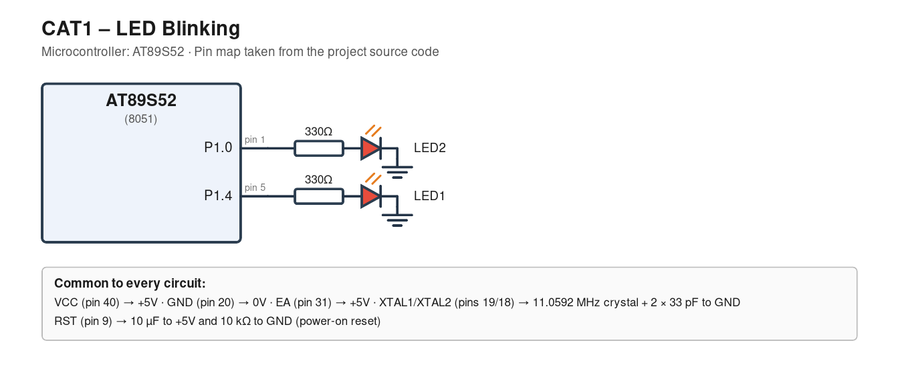

# CAT1 – LED Blinking

| Field | Details |
|---|---|
| **EXP** | CAT1 |
| **DATE** | _fill in (from questions PDF)_ |
| **NAME OF EXP** | _copy exact title from questions PDF_ (working title: LED Blinking) |
| **HARDWARE SETUP / PLATFORM** | AT89S52 (8051) · 11.0592 MHz crystal · Keil µVision (C51) · Proteus · 2 LEDs (P1.4, P1.0) with 330 Ω resistors |
| **TASK NO** | _fill in (from questions PDF)_ |

## Circuit Diagram



## Core Logic

```
loop forever:
    LED1 (P1.4) ON  -> delay -> OFF -> delay
    LED2 (P1.0) ON  -> delay -> OFF -> delay
```

- `delay()` is a software loop (400 x 400 iterations).
- Writing 1 to a port pin drives the LED (active high).

## INFERENCE

A simple software delay loop is enough to blink LEDs one after another. The delay length depends on the crystal frequency and compiler, so it has to be tuned by trial.

## Files

- `Ex1.c` – source code
- `Ex1.uvproj` – Keil µVision project
- `Objects/Ex1.hex` – compiled firmware (load into Proteus / flash to the chip)
- `circuit.png` / `circuit.svg` – circuit diagram
