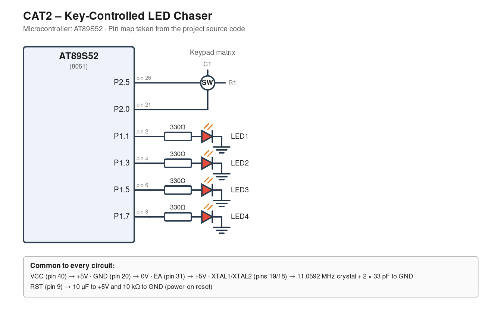

# EXPERIMENT DETAILS

**EXP:** CONTINUOUS ASSESSMENT 2

**DATE:** _fill in_

**NAME OF EXP:** 8051 Tool Chain Setup – Development Board – AT89S52

**HARDWARE SETUP / PLATFORM:** AT89S52 Development Kit (11.0952 MHz crystal) + Keil µVision (C51) + 2 LEDs

---

## Overview

Set up the 8051 tool chain (Keil µVision, C51 compiler, ISP programmer) and run the first bare-metal programs on the AT89S52 board: blink LEDs with a software delay, then move the delay into a reusable library.

**Expected outcome:** The LEDs blink at the programmed rate, and the same blink works with the custom `delay_ms()` library.

## Circuit Diagram

- **Microcontroller:** AT89S52 (8051 core) on the AT89S52 development kit
- **LEDs (Task 2B):** P1.4 (LED1) and P1.0 (LED2), active-high, through 330 Ω to GND
- **LED (Task 2C):** Built-in user LED on P1.0 (active-low)
- **Power Supply:** 5V DC

## Tasks

| Task | What it does | Outcome |
|---|---|---|
| [TASK 2B Bare-Metal LED Blink](TASK2B/) | Blinks two LEDs one after the other using a nested-loop software delay | LEDs blink alternately |
| [TASK 2C Customed Library Function for Delay Functionality](TASK2C/) | Moves the delay into `delay.h` / `delay.c` and blinks the LED with `delay_ms(500)` | Reusable 1 ms-calibrated delay library |

Each task folder contains its Keil µVision project (`.uvproj`, C source, `STARTUP.A51`, `Objects/*.hex`) and a README with the task's hardware, core logic, pseudocode, code base and inference.
