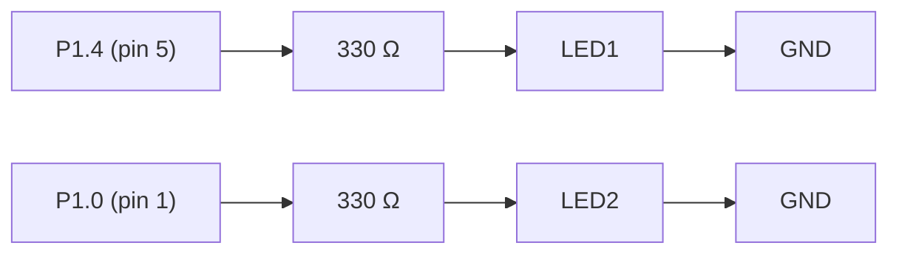

# CAT1 – LED Blinking

**Experiment:** CONTINUOUS ASSESSMENT 1 – LED Blinking

## 1. Hardware Used

- **Microcontroller:** AT89S52 (8051 core) on the AT89S52 development kit
- **GPIO Port / Pins (LEDs):** Port 1 – P1.4 (LED1), P1.0 (LED2)
- **Peripherals:** 2 external LEDs (active-high, anode through a 330 Ω resistor to the port pin, cathode to GND)
- **Power Supply:** 5V DC
- **Circuit diagram:** shown below.

### Circuit Diagram

## 2. Core Logic / Pseudocode / Code Base

**Working Principle:**

Two LEDs are connected to Port 1. The microcontroller switches each pin HIGH and LOW. A software delay (nested 400 × 400 loops) between the changes makes the blinking visible. LED1 blinks first, then LED2, and this repeats forever.

**Pseudocode:**

1. Include the 8051 register definition file `reg51.h`.
2. Define P1.4 as LED1 and P1.0 as LED2.
3. Create a delay function using nested loops.
4. Turn LED1 ON, call delay, turn it OFF, call delay.
5. Turn LED2 ON, call delay, turn it OFF, call delay.
6. Repeat continuously.

**Code Base:**

- `sbit led1 = P1^4;` and `sbit led2 = P1^0;` map each LED to its port bit.
- `delay()` uses nested `for` loops to waste time.
- `main()` runs an infinite `while(1)` loop that blinks LED1 and then LED2.

## 3. Inference

The LEDs blink one after the other as the pins alternate between HIGH and LOW. The experiment shows GPIO output control and software delays in embedded C on the 8051.
