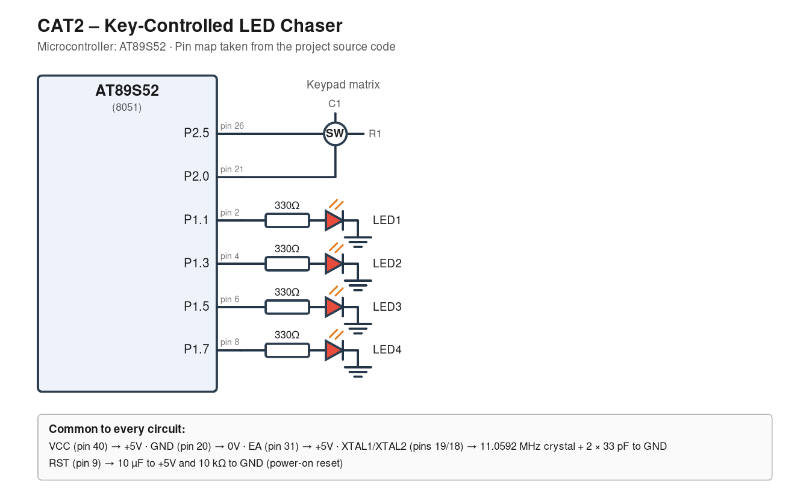

# TASK 2B Bare-Metal LED Blink

**Experiment:** [CONTINUOUS ASSESSMENT 2 – 8051 Tool Chain Setup – Development Board – AT89S52](../README.md)

---

### 1. Hardware Used

- **Microcontroller:** AT89S52 (8051 core) on the AT89S52 development kit
- **GPIO Port / Pins:** Port 1 – P1.4 (LED1), P1.0 (LED2)
- **Peripheral:** 2 LEDs, active-high, each through a 330 Ω resistor to GND
- **Power Supply:** 5V DC

### 2. Core Logic / Pseudocode / Code Base

**Working Principle:**

Two LEDs are connected to Port 1. The program sets a pin HIGH to light its LED and LOW to turn it off. A software delay made of two nested `for` loops (400 × 400) gives a visible gap between the changes. LED1 blinks once, then LED2, and this repeats forever.

**Pseudocode:**

1. Include `reg51.h` and define P1.4 as `led1` and P1.0 as `led2`.
2. Write `delay()` with two nested loops.
3. Set `led1 = 1`, call `delay()`, set `led1 = 0`, call `delay()`.
4. Do the same for `led2`.
5. Repeat in an infinite loop.

**Code Base:**

- `sbit led1 = P1^4;` and `sbit led2 = P1^0;` map the LEDs to port bits.
- `delay()` is a blocking nested-loop delay.
- `main()` runs the blink sequence inside `while(1)`.

### 3. Inference

The LEDs blink alternately, which confirms the tool chain works end to end: the C program compiles, the HEX file is flashed and the port pins drive the LEDs. The exact blink rate depends on the loop counts and the crystal, so it is only approximate.
