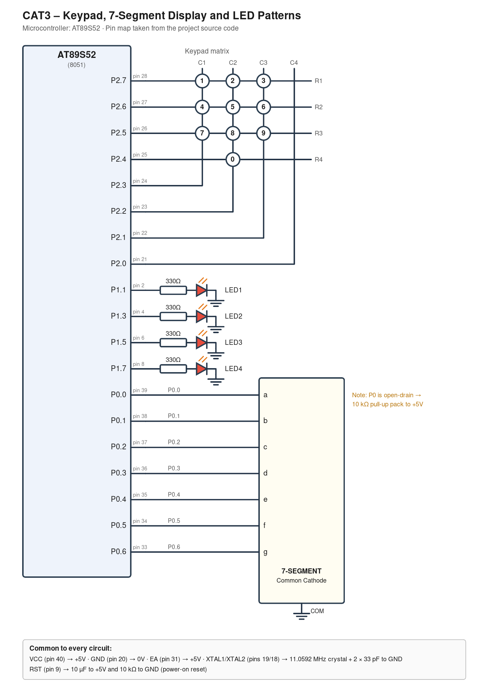

# CAT3 – Keypad, 7-Segment Display and LED Patterns

| Field | Details |
|---|---|
| **EXP** | CAT3 |
| **DATE** | _fill in (from questions PDF)_ |
| **NAME OF EXP** | _copy exact title from questions PDF_ (working title: Keypad, 7-Segment Display and LED Patterns) |
| **HARDWARE SETUP / PLATFORM** | AT89S52 (8051) · 11.0592 MHz crystal · Keil µVision (C51) · Proteus · 4x3 keypad (rows P2.7–P2.4, columns P2.3–P2.1) · common-cathode 7-segment on Port 0 · 4 LEDs (P1.1, P1.3, P1.5, P1.7) |
| **TASK NO** | _fill in (from questions PDF)_ |

## Circuit Diagram



## Core Logic

```
scan keypad row by row
key 1-4 : show digit on 7-seg, light that LED only
key 5   : show 5, running LED (LED1 -> LED2 -> LED3 -> LED4)
key 6   : show 6 only
key 7   : show 7, alternate LED pairs (1,3) and (2,4)
key 8   : show 8, blink all LEDs
key 9   : show 9, all LEDs off
key 0   : show 0 only
```

- The 7-segment uses these Port 0 codes: 0=0x3F, 1=0x06, 2=0x5B, 3=0x4F, 4=0x66, 5=0x6D, 6=0x7D, 7=0x07, 8=0x7F, 9=0x6F.
- Each key press is checked twice with a small delay (debounce).

## INFERENCE

The keypad is scanned in software and each key selects a display digit and an LED pattern. Debouncing is needed so one press is not read as many.

## Files

- `Ex4.c` – source code
- `Ex4.uvproj` – Keil µVision project
- `Objects/Ex4.hex` – compiled firmware (load into Proteus / flash to the chip)
- `circuit.png` / `circuit.svg` – circuit diagram
