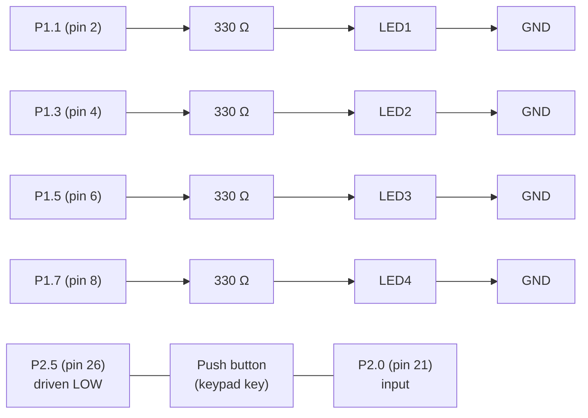

# CAT2 – Key-Controlled LED Chaser

**Experiment:** CONTINUOUS ASSESSMENT 2 – Key-Controlled LED Chaser

## 1. Hardware Used

- **Microcontroller:** AT89S52 (8051 core) on the AT89S52 development kit
- **GPIO Port / Pins (LEDs):** Port 1 – P1.1 (LED1), P1.3 (LED2), P1.5 (LED3), P1.7 (LED4)
- **GPIO Port / Pins (Button):** Port 2 – P2.0 (keypad column, input), P2.5 (keypad row, driven low)
- **Peripherals:** 4 external LEDs (active-high, through 330 Ω resistors to GND); one key of the kit's keypad as the push-button
- **Power Supply:** 5V DC
- **Circuit diagram:** shown below.

### Circuit Diagram

## 2. Core Logic / Pseudocode / Code Base

**Working Principle:**

The key row P2.5 is held low and the column P2.0 is read. If P2.0 reads 0, the key is pressed. While the key is pressed, the four LEDs light one at a time (LED1 → LED2 → LED3 → LED4) with a software delay (200 × 200 loops) between steps. The LEDs keep their last state when the key is released.

**Pseudocode:**

1. Define the four LED pins and the row (P2.5) and column (P2.0) pins.
2. Drive the row low and read the column in `check()`.
3. If the column is low (key pressed), light LED1 only and wait.
4. Light LED2 only and wait, then LED3, then LED4.
5. Repeat forever.

**Code Base:**

- `sbit` statements map each LED and the keypad lines to port bits.
- `check()` drives the row low and returns 1 if the column is low.
- `delay()` is the software delay between steps.
- `main()` calls `check()` in an infinite loop and runs the LED sequence when it returns 1.

## 3. Inference

A keypad works by driving a row low and reading a column, and a low column means the key is pressed. Here one key starts the LED chaser, which shows basic input reading and output control together.
