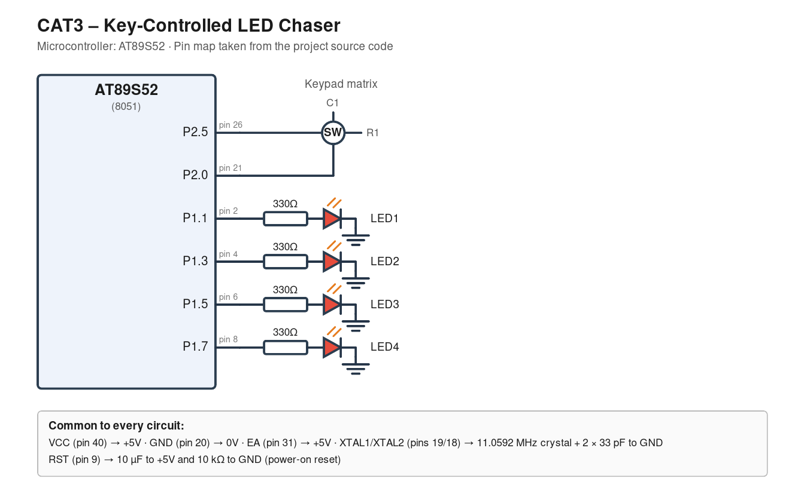

# TASK 3A Key-Controlled LED Chaser

**Experiment:** [CONTINUOUS ASSESSMENT 3 – Button-Controlled LED Pattern Generator](../README.md)

---

### 1. Hardware Used

- **Microcontroller:** AT89S52 (8051 core) on the AT89S52 development kit
- **GPIO Port / Pins (LEDs):** Port 1 – P1.1 (LED1), P1.3 (LED2), P1.5 (LED3), P1.7 (LED4)
- **GPIO Port / Pins (Button):** Port 2 – P2.5 (row, driven low), P2.0 (column, input)
- **Peripherals:** 4 LEDs, one key of the built-in keypad
- **Power Supply:** 5V DC

### 2. Core Logic / Pseudocode / Code Base

**Working Principle:**

The keypad row P2.5 is held low. When the key at the crossing of P2.5 and P2.0 is pressed, P2.0 reads 0. `check()` returns 1 in that case. While it returns 1, the program lights the LEDs one at a time with a software delay (200 × 200 loops) between steps. The LEDs keep their last state when the key is released.

**Pseudocode:**

1. Define the four LED pins and the keypad row (P2.5) and column (P2.0).
2. In `check()`, drive the row low and return 1 if the column is low.
3. In the main loop, call `check()`.
4. If it returns 1: light LED1 only, delay, LED2 only, delay, LED3 only, delay, LED4 only, delay.
5. Repeat forever.

**Code Base:**

- `sbit` statements map the LEDs and keypad lines to port bits.
- `check()` reads the button through the keypad matrix.
- `delay()` is the software delay between steps.
- `main()` runs the chaser when `check()` returns 1.

### 3. Inference

A matrix keypad key is read by driving its row low and reading its column: a low column means the key is pressed. One key is enough to start and stop a multi-LED pattern, which shows GPIO input and output used together.
