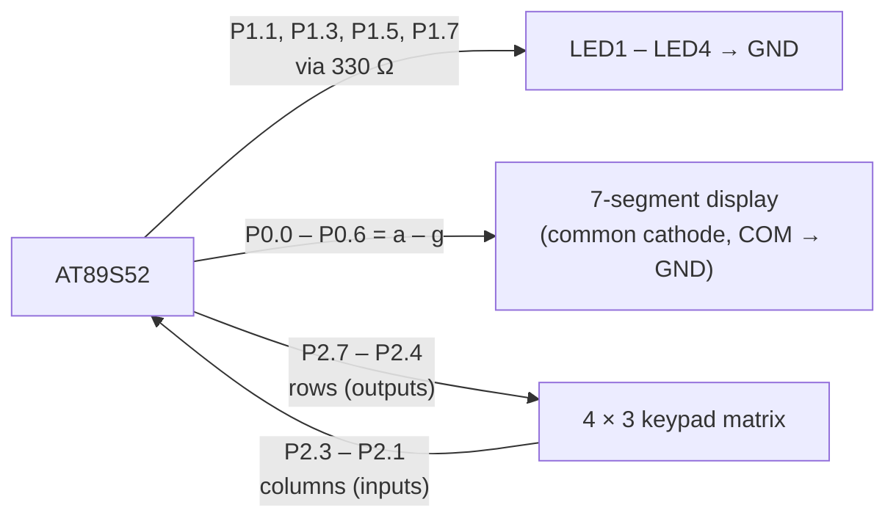

# CAT3 – Keypad, 7-Segment Display and LED Patterns

**Experiment:** CONTINUOUS ASSESSMENT 3 – Keypad Controlled 7-Segment Display and LED Patterns

## 1. Hardware Used

- **Microcontroller:** AT89S52 (8051 core) on the AT89S52 development kit
- **GPIO Port / Pins (LEDs):** Port 1 – P1.1 (LED1), P1.3 (LED2), P1.5 (LED3), P1.7 (LED4)
- **GPIO Port / Pins (Keypad):** Port 2 – rows P2.7–P2.4 (outputs, driven low one at a time); columns P2.3–P2.1 (inputs). Key 0 is on row 4, column 2
- **GPIO Port / Pins (7-segment):** Port 0 – P0.0–P0.6 drive segments a–g
- **Peripherals:** 4 LEDs with 330 Ω resistors; 4×3 keypad; one common-cathode 7-segment display (COM to GND, P0 needs 10 kΩ pull-ups)
- **Power Supply:** 5V DC
- **Circuit diagram:** shown below.

### Circuit Diagram

## 2. Core Logic / Pseudocode / Code Base

**Working Principle:**

The keypad is scanned row by row. When a key is pressed and still pressed after a short delay (debouncing), its digit is shown on the 7-segment display and the matching LED pattern starts. The 7-segment codes on Port 0 are: 0 = 0x3F, 1 = 0x06, 2 = 0x5B, 3 = 0x4F, 4 = 0x66, 5 = 0x6D, 6 = 0x7D, 7 = 0x07, 8 = 0x7F, 9 = 0x6F.

| Key | 7-segment | LED behaviour (LED1 LED2 LED3 LED4) |
|---|---|---|
| 1 – 4 | Shows the key digit | Only that LED is ON (static) |
| 5 | 5 | Running LED: 1000 → 0100 → 0010 → 0001 |
| 6 | 6 | Display only; LEDs keep their previous state |
| 7 | 7 | Alternating 1010 ↔ 0101 |
| 8 | 8 | All LEDs flash 1111 ↔ 0000 |
| 9 | 9 | All LEDs OFF, patterns stopped |
| 0 | 0 | Display only; LEDs keep their previous state |

**Pseudocode:**

1. Define the LED, keypad and 7-segment pins.
2. Scan each keypad row by driving it low and reading the columns.
3. Confirm a press by reading the column again after a small delay.
4. Show the pressed digit on the 7-segment display.
5. Keys 1–4 light one LED; key 5 starts the running LED; key 7 the alternating pairs; key 8 flashes all LEDs; key 9 turns all LEDs OFF.
6. Run the active pattern and repeat.

**Code Base:**

- `btn()` scans the keypad and returns the key number (or −1).
- `displayNumber()` writes the 7-segment code to Port 0.
- `glowLed()`, `glowPair()` and `glowAll()` set the LED patterns.
- `delay(n)` is the software delay between pattern steps.
- `runningLed`, `altLed` and `blinkLed` hold which pattern is active.

## 3. Inference

Each key selects a display digit and an LED pattern. Scanning the keypad in software, debouncing the key press and storing the active pattern in flags gives a simple interactive controller using only GPIO.
