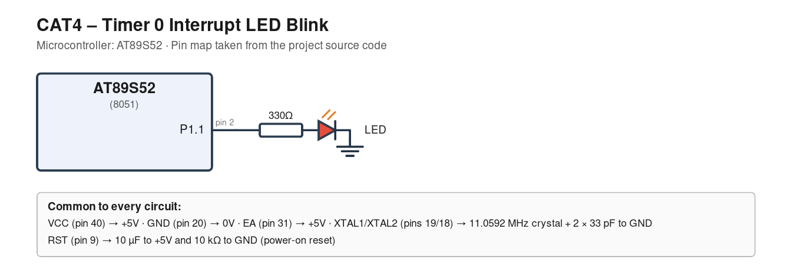

# CAT4 – Timer 0 Interrupt LED Blink

| Field | Details |
|---|---|
| **EXP** | CAT4 |
| **DATE** | _fill in (from questions PDF)_ |
| **NAME OF EXP** | _copy exact title from questions PDF_ (working title: Timer 0 Interrupt LED Blink) |
| **HARDWARE SETUP / PLATFORM** | AT89S52 (8051) · 11.0592 MHz crystal · Keil µVision (C51) · Proteus · 1 LED (P1.1) |
| **TASK NO** | _fill in (from questions PDF)_ |

## Circuit Diagram



## Core Logic

```
init: TMOD = 0x01 (Timer 0, mode 1, 16-bit)
      TH0:TL0 = 0xF199, enable Timer 0 interrupt, EA = 1, start Timer 0
Timer 0 ISR (every overflow):
      reload TH0:TL0 = 0xF199
      count++
      if count == 250: toggle LED, count = 0
main: empty while(1) loop
```

- Reload 0xF199 gives about 3687 timer counts, which is about 4 ms with an 11.0592 MHz crystal.
- 250 x 4 ms is about 1 s between LED toggles.

## INFERENCE

The LED toggles from the Timer 0 interrupt, so the main loop is free for other work. This is more accurate and efficient than a software delay loop.

## Files

- `Ex5.c` – source code
- `Ex5.uvproj` – Keil µVision project
- `Objects/Ex5.hex` – compiled firmware (load into Proteus / flash to the chip)
- `circuit.png` / `circuit.svg` – circuit diagram
