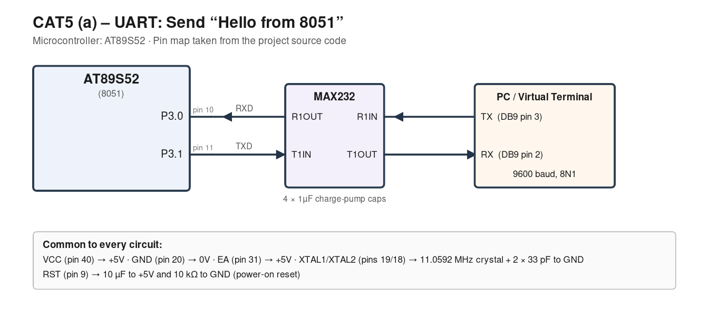

# CAT5 (5a) – UART – Send Text to PC

| Field | Details |
|---|---|
| **EXP** | CAT5 (5a) |
| **DATE** | _fill in (from questions PDF)_ |
| **NAME OF EXP** | _copy exact title from questions PDF_ (working title: UART – Send Text to PC) |
| **HARDWARE SETUP / PLATFORM** | AT89S52 (8051) · 11.0592 MHz crystal · MAX232 level shifter · PC serial terminal / Proteus Virtual Terminal (9600 baud, 8N1) |
| **TASK NO** | _fill in (from questions PDF)_ |

## Circuit Diagram



## Core Logic

```
UART_Init: TMOD = 0x20 (Timer 1, mode 2, auto-reload)
           TH1 = 0xFD  -> 9600 baud at 11.0592 MHz
           SCON = 0x50 (serial mode 1, receive enabled), TR1 = 1
sendChar(c): SBUF = c; wait until TI = 1; clear TI
sendString(s): send each character, then '\r' '\n'
main: loop forever -> sendString("Hello from 8051")
```

## INFERENCE

Timer 1 in mode 2 generates the baud rate. The program must wait for the TI flag after each byte, otherwise characters are lost. _Note: the source was corrected so it compiles (`'\0'` terminator, `sendString` name, TI wait). Rebuild it in Keil to create `Ex6.hex`._

## Files

- `hello.c` – source code
- `Ex6.uvproj` – Keil µVision project
- `STARTUP.A51` – 8051 startup code
- `circuit.png` / `circuit.svg` – circuit diagram
- **`Objects/Ex6.hex` is not included yet.** Rebuild the project in Keil; the hex is created in `Objects/`.
