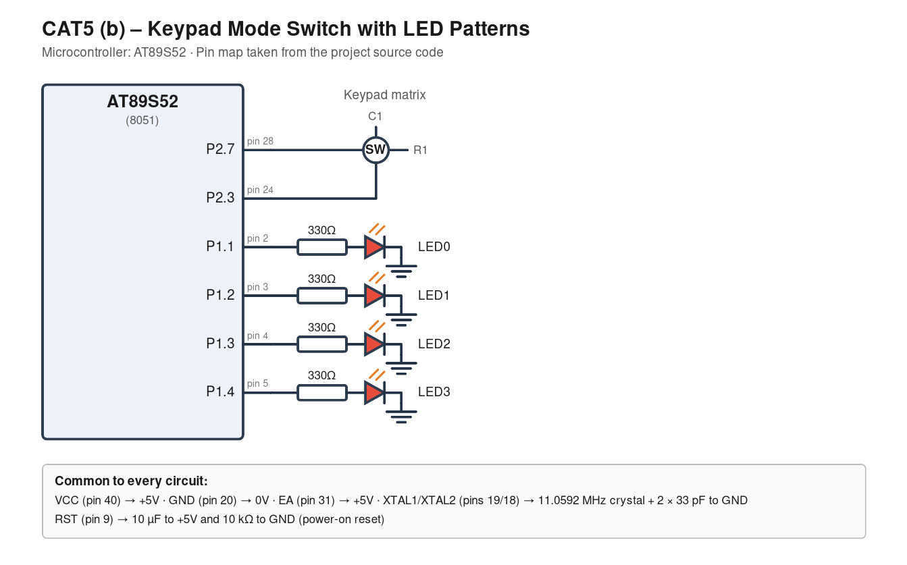

# CAT5 (5b) – Keypad Mode Switch with LED Patterns

| Field | Details |
|---|---|
| **EXP** | CAT5 (5b) |
| **DATE** | _fill in (from questions PDF)_ |
| **NAME OF EXP** | _copy exact title from questions PDF_ (working title: Keypad Mode Switch with LED Patterns) |
| **HARDWARE SETUP / PLATFORM** | AT89S52 (8051) · 11.0592 MHz crystal · Keil µVision (C51) · Proteus · 1 push button (row P2.7, column P2.3) · 4 LEDs (P1.1–P1.4) |
| **TASK NO** | _fill in (from questions PDF)_ |

## Circuit Diagram



## Core Logic

```
each press of the key (R1C1) -> mode = (mode + 1) % 4
mode 0: running LED (LED0 -> LED3)
mode 1: LEDs show a 4-bit binary counter (0..15)
mode 2: alternate LED pairs (0,2) and (1,3)
mode 3: all LEDs blink
```

- The key is polled inside the delay loop, so a press changes the mode immediately.

## INFERENCE

Checking the key inside the delay works like a simple software interrupt. The pattern changes at once instead of waiting for it to finish.

## Files

- `cat3.c` – source code
- `NeelCAT3.uvproj` – Keil µVision project
- `Objects/NeelCAT3.hex` – compiled firmware
- `circuit.png` / `circuit.svg` – circuit diagram
