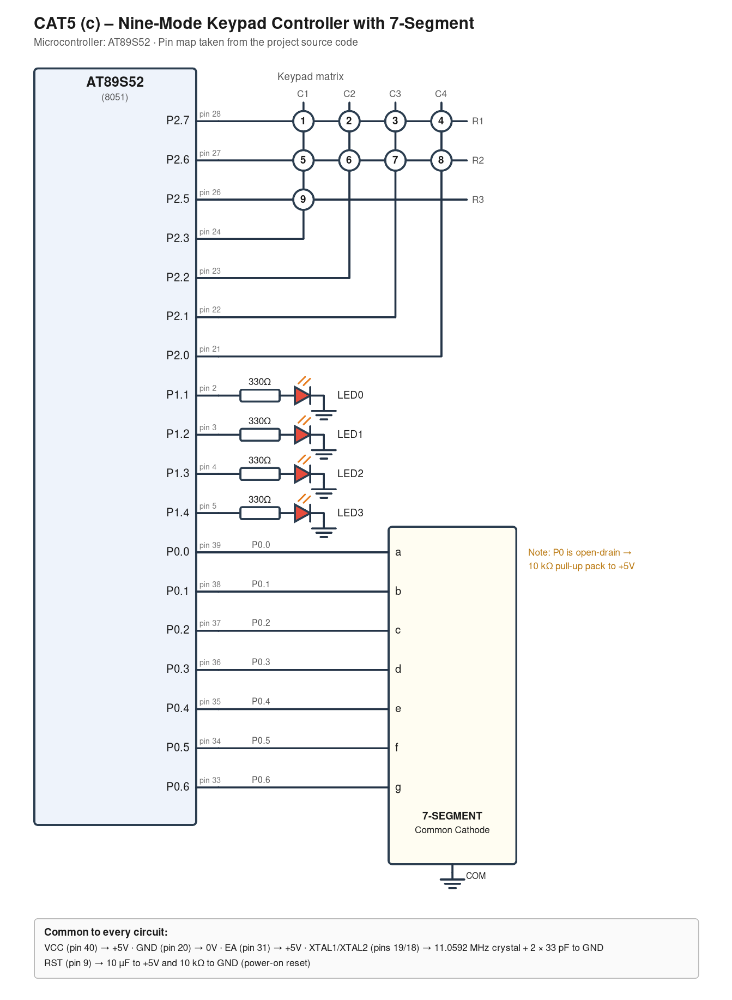

# CAT5 (5c) – Nine-Mode Keypad Controller with 7-Segment

| Field | Details |
|---|---|
| **EXP** | CAT5 (5c) |
| **DATE** | _fill in (from questions PDF)_ |
| **NAME OF EXP** | _copy exact title from questions PDF_ (working title: Nine-Mode Keypad Controller with 7-Segment) |
| **HARDWARE SETUP / PLATFORM** | AT89S52 (8051) · 11.0592 MHz crystal · Keil µVision (C51) · Proteus · keypad (rows P2.7–P2.5, columns P2.3–P2.0) · common-cathode 7-segment on Port 0 · 4 LEDs (P1.1–P1.4) |
| **TASK NO** | _fill in (from questions PDF)_ |

## Circuit Diagram



## Core Logic

```
keys 1-8 are on rows 1-2 (columns 1-4); key 9 is row 3, column 1
key 1-4 : that LED stays on
key 5   : running LED
key 6   : alternate LED pairs
key 7   : 4-bit binary counter on LEDs
key 8   : all LEDs blink
key 9   : all LEDs off
7-segment shows the key number of the active mode
```

- The mode is changed from inside the delay routine, so a new key press takes effect straight away.

## INFERENCE

A single keypad can select many modes. Showing the mode number on the 7-segment gives the user clear feedback.

## Files

- `cat4.c` – source code
- `NeelCAT4.uvproj` – Keil µVision project
- `Objects/NeelCAT4.hex` – compiled firmware
- `circuit.png` / `circuit.svg` – circuit diagram
