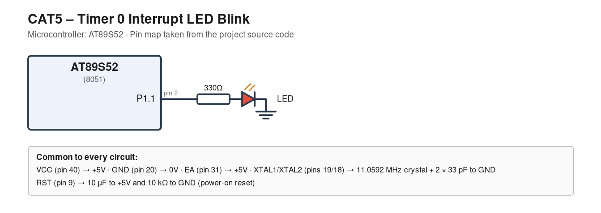

# CAT5 – Timer 0 Interrupt LED Blink

**Experiment:** CONTINUOUS ASSESSMENT 5 – Timer 0 Interrupt Based LED Blink

## 1. Hardware Used

- **Microcontroller:** AT89S52 (8051 core) on the AT89S52 development kit
- **GPIO Port / Pins (LED):** Port 1 – P1.1 (LED)
- **Peripherals:** 1 external LED (active-high, through a 330 Ω resistor to GND); internal Timer 0 in mode 1 (16-bit). Assuming an 11.0592 MHz crystal.
- **Power Supply:** 5V DC
- **Circuit diagram:** shown below.

### Circuit Diagram

## 2. Core Logic / Pseudocode / Code Base

**Working Principle:**

Timer 0 runs in mode 1 and is loaded with 0xF199, so it overflows after about 3687 counts (≈ 4 ms). Each overflow triggers the Timer 0 interrupt. The interrupt routine reloads the timer and counts overflows. After 250 overflows (≈ 1 s) the LED is toggled. The main loop stays empty, so the blinking is fully interrupt driven.

**Pseudocode:**

1. Define P1.1 as the LED and set the LED OFF.
2. Set `TMOD = 0x01` (Timer 0, mode 1) and load `TH0 = 0xF1`, `TL0 = 0x99`.
3. Enable the Timer 0 interrupt (`ET0 = 1`) and the global interrupt (`EA = 1`).
4. Start Timer 0 (`TR0 = 1`).
5. In the interrupt routine: reload the timer and increment `count`.
6. When `count` reaches 250, toggle the LED and reset `count`.
7. The main loop does nothing.

**Code Base:**

- `timer0_ISR()` is the interrupt service routine for Timer 0 (`interrupt 1`).
- `TMOD`, `TH0`, `TL0`, `TR0`, `ET0` and `EA` configure and start the timer interrupt.
- `count` counts the overflows to build a 1 second interval.

## 3. Inference

The LED toggles about every second without any delay loop in `main()`. Using a timer interrupt gives accurate timing and leaves the CPU free for other work.
