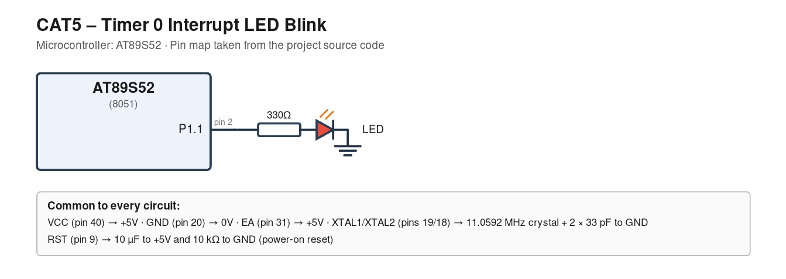

# TASK 5A Timer 0 Interrupt LED Blink

**Experiment:** [CONTINUOUS ASSESSMENT 5 – Hardware Timer-Based LED Blinking](../README.md)

---

### 1. Hardware Used

- **Microcontroller:** AT89S52 (8051 core) on the AT89S52 development kit
- **GPIO Port / Pin:** Port 1 – P1.1 (LED)
- **Timer:** Timer 0, mode 1 (16-bit), `TMOD = 0x01`, reload `TH0:TL0 = 0xF199`
- **Peripheral:** 1 LED, active-high, through 330 Ω to GND
- **Power Supply:** 5V DC

### 2. Core Logic / Pseudocode / Code Base

**Working Principle:**

Timer 0 counts machine cycles. Loaded with 0xF199 it overflows after 0x10000 − 0xF199 = 3687 counts, which is about 4 ms with the 11.0952 MHz crystal (one machine cycle ≈ 1.085 µs). Each overflow calls the Timer 0 interrupt service routine. The ISR reloads the timer, increments `count`, and after 250 overflows (≈ 1 s) toggles the LED and resets `count`. The main loop is empty.

**Pseudocode:**

1. Define P1.1 as `LED` and turn it off.
2. Set `TMOD = 0x01` and load `TH0 = 0xF1`, `TL0 = 0x99`.
3. Enable the Timer 0 interrupt (`ET0 = 1`) and global interrupts (`EA = 1`).
4. Start the timer with `TR0 = 1`.
5. In the ISR (`interrupt 1`): reload `TH0:TL0`, increment `count`.
6. If `count == 250`: toggle `LED`, reset `count`.
7. `main()` waits in an empty `while(1)`.

**Code Base:**

- `timer0_ISR()` with `interrupt 1` is the Timer 0 service routine.
- `TMOD`, `TH0`, `TL0`, `TR0`, `ET0`, `EA` set up and start the timer and interrupt.
- `count` builds the 1 s interval from 4 ms overflows.

### 3. Inference

The LED toggles at a steady rate without any delay loop in `main()`. A hardware timer with an interrupt gives accurate, repeatable timing and leaves the CPU free for other work, unlike a software delay.
