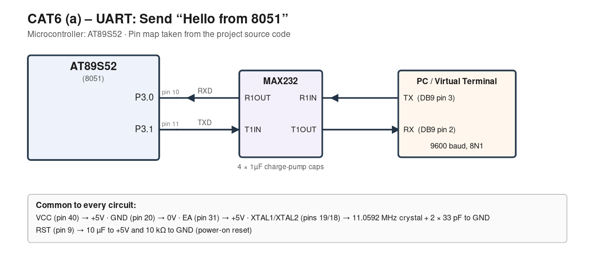

# CAT6 (5a) – UART Serial Transmission

**Experiment:** CONTINUOUS ASSESSMENT 6 – Sending Text from the 8051 over UART

## 1. Hardware Used

- **Microcontroller:** AT89S52 (8051 core) on the AT89S52 development kit
- **GPIO Port / Pins:** Port 3 – P3.1 (TXD), P3.0 (RXD)
- **Peripherals:** MAX232 level shifter to a PC serial terminal (or Proteus Virtual Terminal) set to 9600 baud, 8 data bits, no parity, 1 stop bit. Assuming an 11.0592 MHz crystal.
- **Power Supply:** 5V DC
- **Circuit diagram:** shown below.

### Circuit Diagram

_Note: `Objects/Ex6.hex` is created when the project is built in Keil._

## 2. Core Logic / Pseudocode / Code Base

**Working Principle:**

Timer 1 runs in mode 2 (8-bit auto-reload) as the baud rate generator. With `TH1 = 0xFD` the baud rate is 9600. The serial port is set to mode 1 (`SCON = 0x50`). Each character is written to `SBUF`, and the program waits until the TI flag is set before sending the next one. The string "Hello from 8051" is sent followed by a carriage return and line feed, again and again.

**Pseudocode:**

1. Include `reg51.h`.
2. Set `TMOD = 0x20` (Timer 1, mode 2), `TH1 = TL1 = 0xFD`, `SCON = 0x50` and start Timer 1.
3. `sendChar()` writes a byte to `SBUF`, waits for `TI = 1` and clears `TI`.
4. `sendString()` sends each character of the string, then `\r` and `\n`.
5. In `main()`, call `sendString("Hello from 8051")` forever.

**Code Base:**

- `UART_Init()` configures Timer 1 and the serial port.
- `sendChar()` transmits one character.
- `sendString()` transmits a whole string with a new line.

## 3. Inference

The 8051 sends the text to the PC terminal at 9600 baud. Timer 1 sets the baud rate, and waiting for the TI flag stops characters from being lost.
