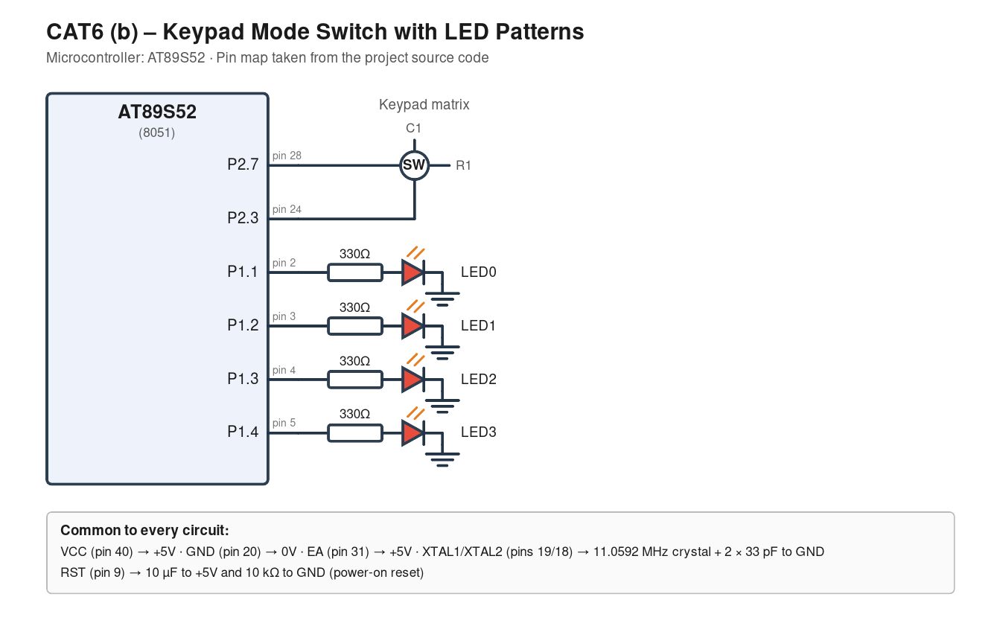
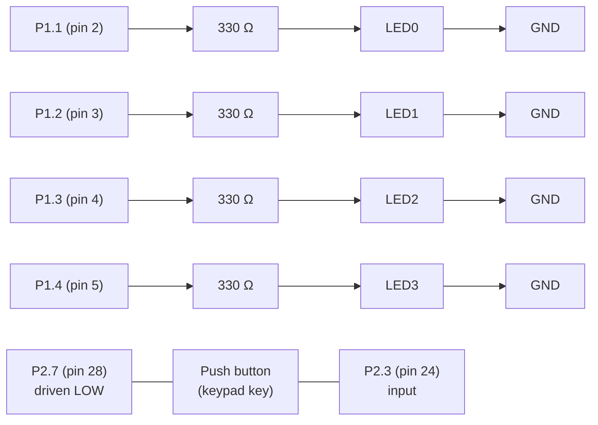

# CAT6 (5b) – Keypad Mode Switch with LED Patterns

**Experiment:** CONTINUOUS ASSESSMENT 6 – Four-Mode LED Controller

## 1. Hardware Used

- **Microcontroller:** AT89S52 (8051 core) on the AT89S52 development kit
- **GPIO Port / Pins (LEDs):** Port 1 – P1.1 (LED0), P1.2 (LED1), P1.3 (LED2), P1.4 (LED3)
- **GPIO Port / Pins (Button):** Port 2 – P2.7 (keypad row 1, driven low), P2.3 (keypad column 1, input)
- **Peripherals:** 4 LEDs (active-high, through 330 Ω resistors to GND); one key of the kit's keypad as the push-button
- **Power Supply:** 5V DC
- **Circuit diagram:** shown below.

### Circuit Diagram

## 2. Core Logic / Pseudocode / Code Base

**Working Principle:**

The key is read while the program runs and also inside the delay loop. Each debounced press advances `mode` 0 → 1 → 2 → 3 → 0, so the pattern changes straight away instead of waiting for the current pattern to end.

| Mode | LED behaviour (LED0 LED1 LED2 LED3) |
|---|---|
| 0 | Running LED: 1000 → 0100 → 0010 → 0001 |
| 1 | Binary counter 0000 → 1111 |
| 2 | Alternating 1010 ↔ 0101 |
| 3 | All LEDs flash 1111 ↔ 0000 |

**Pseudocode:**

1. Define the LED pins and the keypad row and column pins.
2. Poll the key in `intr()`; on a press, do `mode = (mode + 1) % 4`.
3. Mode 0: light LED0, LED1, LED2, LED3 one after another.
4. Mode 1: show `num` in binary on the LEDs and count 0–15.
5. Mode 2: alternate between 1010 and 0101.
6. Mode 3: alternate between all ON and all OFF.
7. Repeat forever.

**Code Base:**

- `keypress()` drives the row low, waits to debounce and returns 1 on a press.
- `intr()` changes `mode` when a key press is seen.
- `delay()` calls `intr()` while waiting, so a key press interrupts the wait.
- `seq()`, `counter()`, `pattern1()` and `pattern2()` produce the four patterns.

## 3. Inference

One key moves the system through four LED modes. Checking the key inside the delay works like a software interrupt, so the response is immediate.
