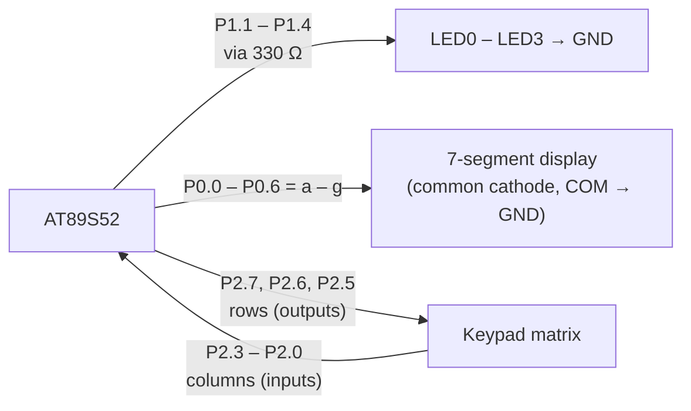

# CAT5 (5c) – Nine-Mode Keypad Controller with 7-Segment

**Experiment:** CONTINUOUS ASSESSMENT 5 – Keypad Mode Selector with 7-Segment Display

## 1. Hardware Used

- **Microcontroller:** AT89S52 (8051 core) on the AT89S52 development kit
- **GPIO Port / Pins (LEDs):** Port 1 – P1.1 (LED0), P1.2 (LED1), P1.3 (LED2), P1.4 (LED3)
- **GPIO Port / Pins (Keypad):** Port 2 – rows P2.7, P2.6, P2.5 (outputs); columns P2.3, P2.2, P2.1, P2.0 (inputs). Keys 1–4 are on row 1, keys 5–8 on row 2, key 9 on row 3 column 1
- **GPIO Port / Pins (7-segment):** Port 0 – P0.0–P0.6 drive segments a–g
- **Peripherals:** 4 LEDs with 330 Ω resistors; keypad; one common-cathode 7-segment display (COM to GND, P0 needs 10 kΩ pull-ups)
- **Power Supply:** 5V DC
- **Circuit diagram:** shown below.

### Circuit Diagram

## 2. Core Logic / Pseudocode / Code Base

**Working Principle:**

Each key 1–9 selects one of nine modes. The key number is shown on the 7-segment display and the matching LED behaviour runs. The key is also checked inside the delay loop, so a new key takes effect immediately.

| Key | 7-segment | LED behaviour (LED0 LED1 LED2 LED3) |
|---|---|---|
| 1 | 1 | LED0 ON |
| 2 | 2 | LED1 ON |
| 3 | 3 | LED2 ON |
| 4 | 4 | LED3 ON |
| 5 | 5 | Running LED: 1000 → 0100 → 0010 → 0001 |
| 6 | 6 | Alternating 1010 ↔ 0101 |
| 7 | 7 | Binary counter 0000 → 1111 |
| 8 | 8 | All LEDs flash 1111 ↔ 0000 |
| 9 | 9 | All LEDs OFF |

**Pseudocode:**

1. Define the LED, keypad and 7-segment pins.
2. `keypress()` scans the rows, debounces the key and stores the key number in `stat`.
3. `intr()` converts `stat` into a mode number and clears the counter.
4. In `main()`, show the mode number on the 7-segment display.
5. Run the LED behaviour for the active mode.
6. Repeat forever.

**Code Base:**

- `display_seg()` writes the 7-segment code to Port 0.
- `keypress()` and `intr()` read the keypad and change the mode.
- `seq()`, `pattern1()`, `counter()` and `pattern2()` produce the LED patterns.
- `main()` uses a `switch(mode)` to run the active mode.

## 3. Inference

A single keypad selects nine different modes, and the 7-segment display shows which mode is active. This gives clear feedback to the user and demonstrates keypad scanning, debouncing and display control together.
