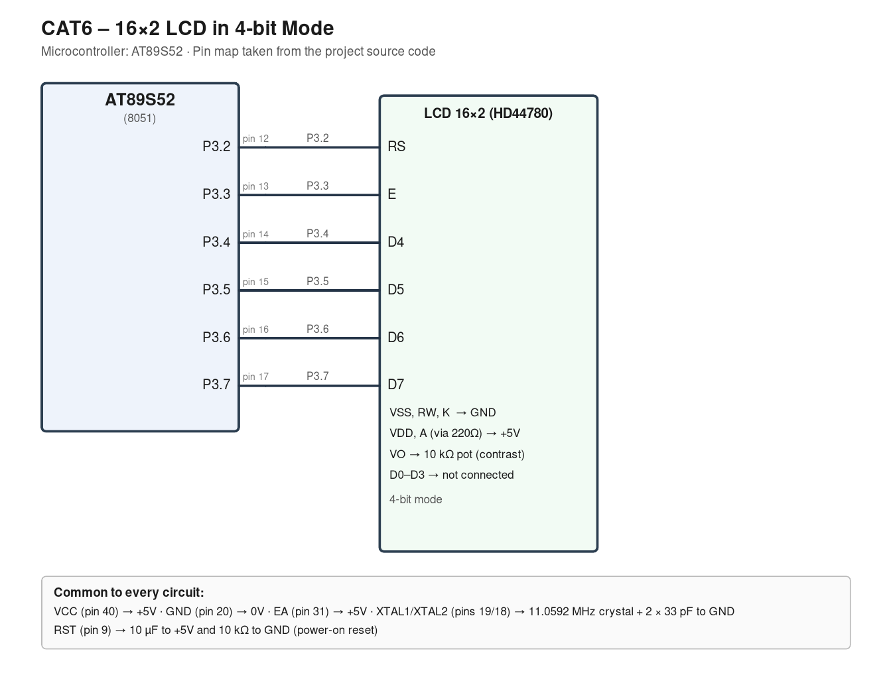

# CAT6 – LCD Display (16x2, 4-bit Mode)

| Field | Details |
|---|---|
| **EXP** | CAT6 |
| **DATE** | _fill in (from questions PDF)_ |
| **NAME OF EXP** | _copy exact title from questions PDF_ (working title: LCD Display (16x2, 4-bit Mode)) |
| **HARDWARE SETUP / PLATFORM** | AT89S52 (8051) · 11.0592 MHz crystal · Keil µVision (C51) · Proteus · 16x2 HD44780 LCD (RS P3.2, E P3.3, D4–D7 on P3.4–P3.7) |
| **TASK NO** | _fill in (from questions PDF)_ |

## Circuit Diagram



## Core Logic

```
lcd_init: wait 20 ms, send 0x30 three times, then 0x20 (switch to 4-bit)
          0x28 (4-bit, 2 lines), 0x0C (display on), 0x06 (cursor right), 0x01 (clear)
lcd_cmd / lcd_data: send upper nibble, pulse E, send lower nibble, pulse E
main: cmd 0x80 -> print "Hello" (line 1)
      cmd 0xCA -> print "World" (line 2, column 11)
```

- RS = 0 for commands, RS = 1 for data. RW is tied to GND (write only).

## INFERENCE

The LCD works with only 4 data lines. Each byte is sent as two nibbles, which saves port pins. The init sequence must be followed exactly.

## Files

- `lcd.c` – source code
- `Ex7.uvproj` – Keil µVision project
- `Objects/Ex7.hex` – compiled firmware (load into Proteus / flash to the chip)
- `circuit.png` / `circuit.svg` – circuit diagram
