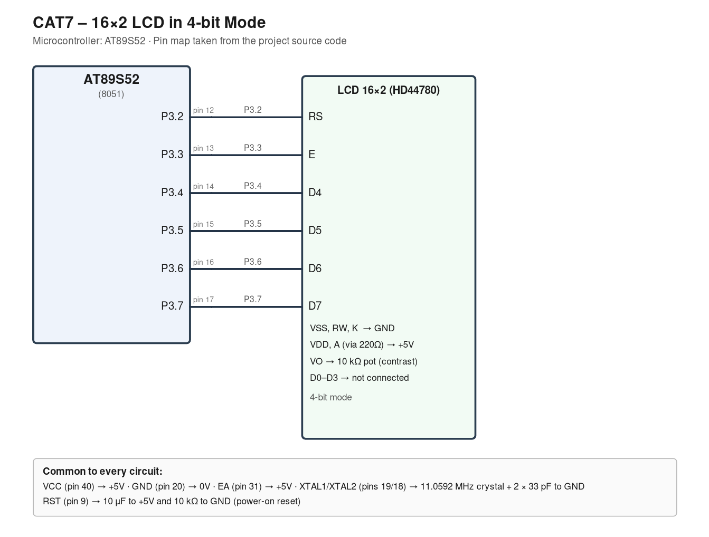

# EXPERIMENT DETAILS

**EXP:** CONTINUOUS ASSESSMENT 7

**DATE:** _fill in_

**NAME OF EXP:** 16×2 LCD Driver Development and Dynamic Display Control

**HARDWARE SETUP / PLATFORM:** AT89S52 Development Kit (11.0952 MHz crystal) + Keil µVision (C51) + 16×2 Character LCD (HD44780) + 4×4 Matrix Keypad

---

## Overview

Write a 4-bit HD44780 LCD driver for the AT89S52 and use it to display characters and strings, position text on both rows, and move a character around the display under keypad control.

**Expected outcome:** Text appears where the program places it on the two LCD rows, and in Task 7C the keypad moves a character across the display.

## Circuit Diagram

- **Microcontroller:** AT89S52 (8051 core) on the AT89S52 development kit
- **LCD:** Built-in 16×2 character LCD on the DS1 header – RS → P3.2, E → P3.3, D4–D7 → P3.4–P3.7, RW → GND (4-bit mode)
- **Keypad (Task 7C):** Built-in 4×4 matrix keypad on Port 2 – rows P2.7–P2.4, columns P2.3–P2.0
- **Power Supply:** 5V DC

## Tasks

| Task | What it does | Outcome |
|---|---|---|
| [TASK 7A LCD Initialization and Character/String Display](TASK7A/) | Initializes the LCD in 4-bit mode and prints a character and two strings using DDRAM addressing | LCD driver and static text on both rows |
| [TASK 7B Two-Row Text Placement](TASK7B/) | Uses the driver to print `Hello` on row 1 and `World` at column 11 of row 2 (`0xCA`) | Text positioned anywhere on the display |
| [TASK 7C 4×4 Keypad-Based Character Movement](TASK7C/) | Scans the keypad and moves a character around the LCD according to the key pressed | Keypad-controlled dynamic display |

Each task folder contains its Keil µVision project (`.uvproj`, C source, `STARTUP.A51`, `Objects/*.hex`) and a README with the task's hardware, core logic, pseudocode, code base and inference.
