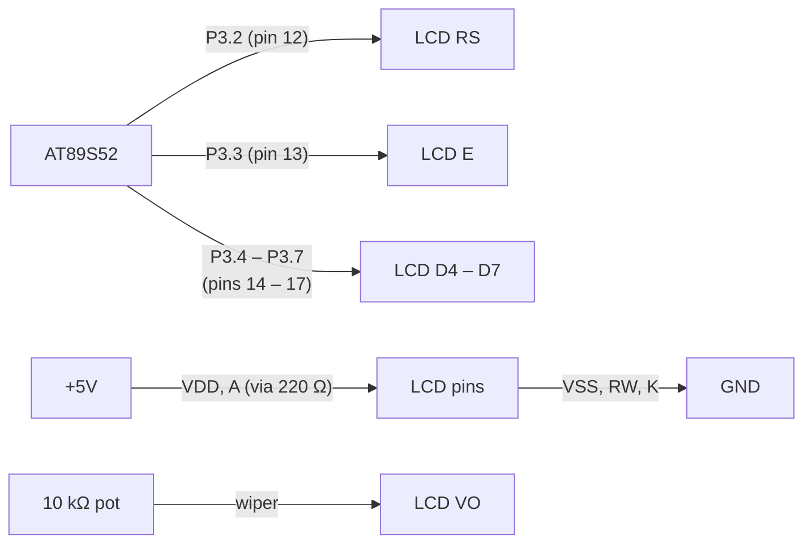

# CAT6 – 16×2 LCD Interfacing

**Experiment:** CONTINUOUS ASSESSMENT 6 – Interfacing a 16×2 LCD in 4-bit Mode

## 1. Hardware Used

- **Microcontroller:** AT89S52 (8051 core) on the AT89S52 development kit
- **GPIO Port / Pins:** Port 3 – P3.2 (RS), P3.3 (E), P3.4 – P3.7 (D4 – D7)
- **Peripherals:** 16×2 HD44780 LCD in 4-bit mode (RW to GND, VO to a 10 kΩ contrast pot, backlight A through 220 Ω to 5V, K to GND)
- **Power Supply:** 5V DC
- **Circuit diagram:** shown below.

### Circuit Diagram

## 2. Core Logic / Pseudocode / Code Base

**Working Principle:**

The LCD is used in 4-bit mode, so each byte is sent as two nibbles (upper first, then lower), each latched with a pulse on E. RS = 0 sends a command and RS = 1 sends data. After the start-up sequence (0x30 three times, then 0x20 to select 4-bit mode), the LCD is set to 2 lines (0x28), display ON (0x0C), cursor right (0x06) and cleared (0x01). "Hello" is written at the start of line 1 (0x80) and "World" at column 11 of line 2 (0xCA).

**Pseudocode:**

1. Define RS and E on P3.2 and P3.3; data lines use P3.4 – P3.7.
2. Wait 20 ms for the LCD to power up.
3. Send 0x30 three times, then 0x20 to switch to 4-bit mode.
4. Send the setup commands 0x28, 0x0C, 0x06 and 0x01.
5. Set the cursor to line 1 (0x80) and print "Hello".
6. Set the cursor to line 2, column 11 (0xCA) and print "World".
7. Stop in an infinite loop.

**Code Base:**

- `lcd_nibble()` puts 4 bits on P3.4 – P3.7 and pulses E.
- `lcd_cmd()` and `lcd_data()` send a byte as two nibbles with RS low or high.
- `lcd_init()` runs the start-up sequence.
- `lcd_puts()` prints a string one character at a time.

## 3. Inference

The LCD shows the text correctly using only six port pins. The 4-bit mode saves pins, and the start-up sequence must be followed exactly for the LCD to work.
