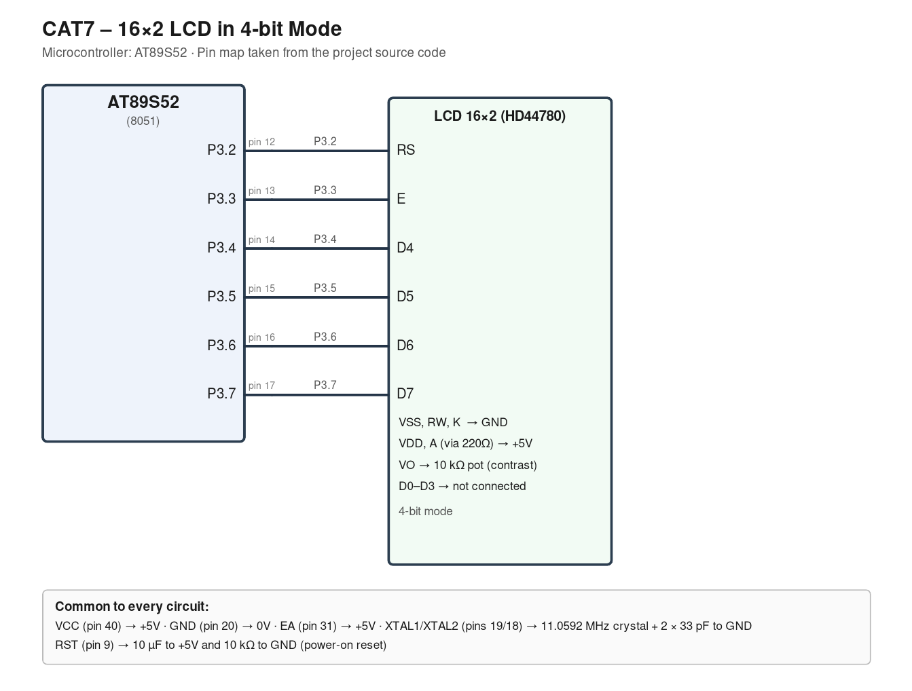

# TASK 7B Two-Row Text Placement

**Experiment:** [CONTINUOUS ASSESSMENT 7 – 16×2 LCD Driver Development and Dynamic Display Control](../README.md)

---

### 1. Hardware Used

- **Microcontroller:** AT89S52 (8051 core) on the AT89S52 development kit
- **LCD Pins:** RS → P3.2, E → P3.3, D4–D7 → P3.4–P3.7, RW → GND (4-bit mode)
- **Peripheral:** Built-in 16×2 character LCD (HD44780-compatible)
- **Power Supply:** 5V DC

### 2. Core Logic / Pseudocode / Code Base

**Working Principle:**

The same 4-bit driver as Task 7A is used. `lcd_init()` runs the HD44780 start-up sequence (three `0x30` nibbles, then `0x20`, then `0x28`, `0x0C`, `0x06`, `0x01`). Each byte goes out as an upper and a lower nibble on P3.4–P3.7, latched by a pulse on E. The cursor is moved with Set DDRAM Address commands: `0x80` is the first position of row 1 and `0xC0` the first position of row 2, so `0xCA` is column 11 of row 2. "Hello" is printed on row 1 and "World" at `0xCA`.

**Pseudocode:**

1. Define RS on P3.2 and E on P3.3; data uses P3.4–P3.7.
2. Initialize the LCD with `lcd_init()`.
3. Send `0x80` and print "Hello" with `lcd_puts()`.
4. Send `0xCA` and print "World".
5. Stop in an infinite loop.

**Code Base:**

- `lcd_nibble()` places 4 bits on P3.4–P3.7 and pulses E.
- `lcd_cmd()` / `lcd_data()` send a command or a character as two nibbles.
- `lcd_init()` performs the 4-bit start-up sequence.
- `lcd_puts()` prints a string.

### 3. Inference

DDRAM addresses let the program place text at any column of either row. Row 2 starts at `0xC0`, so adding the column offset (here 10) gives the address for any position.
