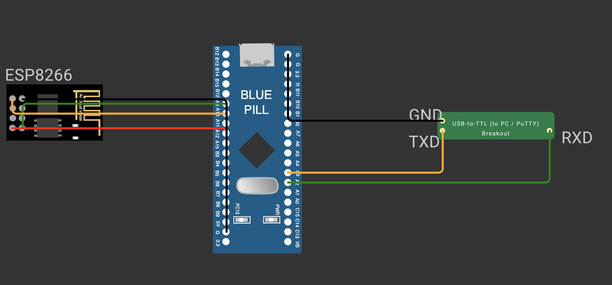

# CAT10 – STM32–Wemos Wi-Fi Modem Interface Using AT Commands

| Field | Details |
|---|---|
| **EXP** | CAT10 (Continuous Lab Evaluation-10) |
| **DATE** | 05/10/2026 (Week 9) |
| **NAME OF EXP** | STM32–Wemos Wi-Fi Modem Interface Using AT Commands |
| **HARDWARE SETUP / PLATFORM** | STM32 board _(add exact model)_ · Wemos D1 Mini (ESP8266) · STM32CubeMX · Keil MDK · STM32 HAL · PuTTY / Tera Term |
| **TASK NO** | 9A, 9B, 9C |

**Problem statement:** Interface an STM32 board with a Wemos Mini / ESP8266 through UART, configure the Wi-Fi modem using AT commands, and show the responses on the PC terminal.

## Circuit Diagram



| Wemos D1 Mini pin | STM32 pin | Description |
|---|---|---|
| TX | RX (e.g. PA3 / USART2_RX) | Data from Wemos to STM32 |
| RX | TX (e.g. PA2 / USART2_TX) | Data from STM32 to Wemos |
| GND | GND | Common ground |
| 5V / 3.3V | 5V / 3.3V | Power for the Wemos |

_Update the pins above to match what you actually wired (UART1 for Wemos, UART2 for PC if used)._

---

## Task 9A – Establish STM32 ↔ Wemos UART Communication

**Core logic**

```
STM32 sends "AT\r\n" over UART to Wemos
Wemos replies "OK\r\n"
STM32 receives the reply and forwards it to the PC terminal
```

**Inference:** _write what you observed (e.g. the Wemos answered OK, so the UART link works)._

## Task 9B – Explore the ESP8266 AT Command Interface

| Requirement | Command used | Response observed |
|---|---|---|
| Check modem response | `AT` | _fill in_ |
| Check firmware / version | `AT+GMR` | _fill in_ |
| Set Wi-Fi station mode | `AT+CWMODE=1` | _fill in_ |
| Scan available networks | `AT+CWLAP` | _fill in_ |
| Connect to an AP | `AT+CWJAP="SSID","password"` | _fill in_ |
| Obtain network information | `AT+CIFSR` | _fill in_ |
| Establish TCP connection | _fill in_ | _fill in_ |
| Send application data | _fill in_ | _fill in_ |

**Inference:** _fill in._

## Task 9C – Connect Wemos to Wi-Fi

**Core logic**

```
send AT                -> expect OK
send AT+CWMODE=1       -> station mode
send AT+CWJAP="SSID","password" -> wait for WIFI CONNECTED / GOT IP
send AT+CIFSR          -> read IP address
print to PC terminal: WIFI MODE : STATION, WIFI STATUS : CONNECTED, IP ADDRESS : x.x.x.x
```

**Output:** _paste a terminal screenshot here._

**Inference:** _fill in._

## Files

- `Core/` – application sources
- `Drivers/` – HAL drivers
- `*.ioc` – CubeMX configuration
- `*.uvprojx` – Keil project
- `*.hex` – compiled firmware
- `circuit.png` – circuit diagram

_Copy your STM32 project files into this folder._
